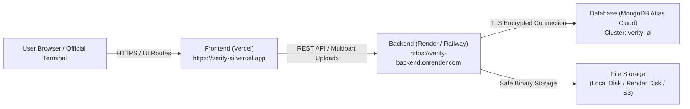

# VERITY AI — Production Deployment Guide (Vercel & Render / Railway)

This guide provides step-by-step instructions for deploying the **VERITY AI Platform** for Smart India Hackathon demonstrations and production environments.

The architecture separates the application into two decoupled tiers:
- **Frontend Tier**: React 19 + TypeScript + Vite Single-Page Application (SPA) deployed on **Vercel**.
- **Backend Tier**: FastAPI (ASGI) + PyMongo + MongoDB Atlas deployed on **Render** (or Railway / AWS).

---

## Architecture Overview



---

## Part 1: Prerequisites & Security Checklist

Before deploying, ensure you have:
1. A **GitHub account** with a new private or public repository created (e.g. `verity-ai-platform`).
2. A **Vercel account** connected to GitHub.
3. A **Render account** (or Railway account) connected to GitHub.
4. A **MongoDB Atlas cluster** with:
   - A dedicated database user (e.g. `verity_admin`).
   - Network Access IP Access List configured (add your Render outbound IP, or your development IP; do **not** leave credentials in public files).

---

## Part 2: Uploading Project to GitHub

Open Windows PowerShell in the project root:

```powershell
cd C:\Users\sridh\Documents\SIH

# 1. Initialize git repository if not already initialized
git init

# 2. Verify .gitignore protects local secrets
# Ensure .env, backend/.env, backend/uploads/, node_modules/, and .venv312 are ignored
git status

# 3. Stage all files
git add .

# 4. Commit changes
git commit -m "feat: complete government-grade UI, two-portal separation, and deployment readiness"

# 5. Link to your GitHub remote repository
git remote add origin https://github.com/<YOUR_GITHUB_USERNAME>/<YOUR_REPOSITORY_NAME>.git

# 6. Push to main branch (ONLY when ready and authorized)
git branch -M main
git push -u origin main
```

> [!CAUTION]
> Ensure `backend/.env` is never committed to GitHub. Only commit `.env.example`.

---

## Part 3: Deploying the FastAPI Backend (Render)

### Step 1: Create a New Web Service on Render
1. Log in to [Render Dashboard](https://dashboard.render.com).
2. Click **New +** → **Web Service**.
3. Connect your GitHub repository (`verity-ai-platform`).
4. Configure the Web Service settings:
   - **Name**: `verity-ai-backend`
   - **Region**: Choose a region closest to your users (e.g., Singapore or Frankfurt).
   - **Branch**: `main`
   - **Root Directory**: `backend` *(CRITICAL: Must be set to `backend`)*
   - **Runtime**: `Python 3`
   - **Build Command**: `pip install -r requirements.txt`
   - **Start Command**: `uvicorn app.main:app --host 0.0.0.0 --port $PORT`
   - **Plan**: `Free` (or Starter for persistent disks)

### Step 2: Configure Backend Environment Variables on Render
Under **Environment Variables**, add the following keys:

| Variable Key | Recommended Value | Description |
|---|---|---|
| `PYTHON_VERSION` | `3.12.0` | Enforces Python 3.12 compatibility |
| `DEBUG` | `False` | Disables debug mode in production |
| `API_PREFIX` | `/api` | Standard API endpoint prefix |
| `MONGODB_URI` | `mongodb+srv://<user>:<password>@<cluster>.mongodb.net/?retryWrites=true&w=majority` | Your Atlas connection string |
| `DATABASE_NAME` | `verity_ai` | Target MongoDB database |
| `MONGODB_TIMEOUT_MS` | `3000` | Atlas connection timeout |
| `CORS_ORIGINS` | `https://<YOUR_VERCEL_APP>.vercel.app,http://localhost:3000` | Allowed frontend domains |
| `UPLOAD_DIR` | `uploads` | Local upload directory path |

### Step 3: Deploy & Verify Backend Health
1. Click **Create Web Service**.
2. Once deployment completes, note your backend URL:
   `https://verity-ai-backend.onrender.com`
3. Test backend liveness in your browser:
   - Health Probe: `https://verity-ai-backend.onrender.com/api/health`
   - Swagger Documentation: `https://verity-ai-backend.onrender.com/docs`

> [!IMPORTANT]
> **Cloud Storage Notice (Ephemeral Filesystem)**:
> Free cloud hosting tiers (like Render free tier) utilize ephemeral disk storage. While MongoDB persists all metadata, SHA-256 hashes, and audit entries permanently, uploaded binary PDF files in `backend/uploads/` will reset upon container restart unless a **Render Persistent Disk** (`/var/data/uploads`) is mounted or cloud object storage (AWS S3) is integrated.

---

## Part 4: Deploying the React Frontend (Vercel)

### Step 1: Import Project in Vercel
1. Log in to [Vercel Dashboard](https://vercel.com).
2. Click **Add New...** → **Project**.
3. Import your GitHub repository (`verity-ai-platform`).

### Step 2: Configure Project Settings
- **Project Name**: `verity-ai` (or your chosen name)
- **Framework Preset**: `Vite` (automatically detected)
- **Root Directory**: `./` (leave as root)
- **Build Command**: `npm run build` (`tsc && vite build`)
- **Output Directory**: `dist`
- **Install Command**: `npm install`

### Step 3: Add Frontend Environment Variable
In the **Environment Variables** section on Vercel:

| Key | Value | Description |
|---|---|---|
| `VITE_API_BASE_URL` | `https://verity-ai-backend.onrender.com` | Deployed backend URL (without trailing slash) |

### Step 4: Deploy
1. Click **Deploy**.
2. Deployment completes in ~45 seconds.
3. Your production frontend URL will be generated:
   `https://verity-ai.vercel.app`

### Step 5: Update Backend CORS
Return to Render, open **Environment Variables**, and ensure `CORS_ORIGINS` includes your live Vercel domain:
```env
CORS_ORIGINS=https://verity-ai.vercel.app,http://localhost:3000
```
Click **Save Changes** (Render will trigger a zero-downtime redeploy).

---

## Part 5: End-to-End Verification of Deployed App

Execute this 5-point verification checklist on the live deployment:

1. **SPA Routing Test**:
   - Open `https://verity-ai.vercel.app/dashboard`.
   - Refresh the page (`F5`).
   - Expected: The page reloads seamlessly without a 404 (handled by `vercel.json`).

2. **Role Separation Test**:
   - Visit `/login`. Select **AICTE Official** → Verify Scrutiny Dossier features.
   - Return to `/login`. Select **Institution** → Verify that you are routed to `/institution-dashboard` with Academic & Faculty records.
   - Try opening another college's application (e.g. `/applications/AICTE-EOA-2026-002`) while signed in as Institution → Verify the institutional boundary guard displays access restriction.

3. **Backend Health Check**:
   - Verify `/api/health` returns `{"status": "healthy", "database_connected": true}`.

4. **Document Ingestion Test**:
   - In `/institution-dashboard`, click **Upload Statutory Document**.
   - Select a sample PDF (< 10 MB).
   - Expected: HTTP 201 Created response with SHA-256 hash displayed in the dialog.
   - Attempt to upload the identical file again → Expected: HTTP 409 Conflict duplicate error displayed gracefully.

5. **Faculty Administration Test**:
   - Under `/institution-dashboard`, switch to the **Academic & Faculty Information** tab.
   - Verify department switching (CSE, AI&DS, ECE, MECH), cadre distribution gauges, and CSV roster export.

